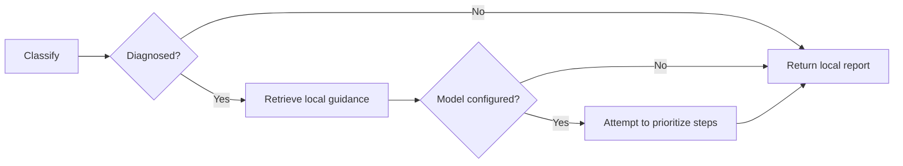

# K8s Incident Copilot

**An AI-Powered Kubernetes Incident Diagnosis Assistant**

K8s Incident Copilot helps triage Kubernetes Pod failures from the status, events, and logs you provide. The FastAPI service uses deterministic rules to suggest a likely cause and show what triggered the diagnosis. Retrieval mode adds guidance from bundled Kubernetes documentation. Agent mode coordinates those same local tools and can optionally ask a model to prioritize the recommended steps. You can run all three modes offline without a cluster, kubeconfig, or API key. An opt-in endpoint can also read live observations for a Pod in one configured namespace.

| Supported failure | What it signals | Kubernetes documentation |
| --- | --- | --- |
| `CrashLoopBackOff` | A container has repeatedly failed and Kubernetes is delaying its next restart. | [Pod lifecycle](https://kubernetes.io/docs/concepts/workloads/pods/pod-lifecycle/) |
| `ImagePullBackOff` | Kubernetes failed to pull a container image and is delaying its next attempt. | [Container images](https://kubernetes.io/docs/concepts/containers/images/) |
| `OOMKilled` | The container was reported as terminated after running out of memory. | [Resource management for Pods and containers](https://kubernetes.io/docs/concepts/configuration/manage-resources-containers/) |

## Run locally

From the repository root, create a virtual environment and start the API. No environment variables are required for local diagnosis. If you are upgrading an existing checkout, rerun the editable install to update its runtime dependencies.

**Windows PowerShell** (with Python 3.13 installed):

```powershell
py -3.13 -m venv .venv
.venv\Scripts\python.exe -m pip install -e '.[dev]'
.venv\Scripts\python.exe -m uvicorn k8s_incident_copilot.main:app
```

**macOS or Linux** (Python 3.11 or later):

```sh
python3 -m venv .venv
.venv/bin/python -m pip install -e '.[dev]'
.venv/bin/python -m uvicorn k8s_incident_copilot.main:app
```

Open [the interactive API docs](http://127.0.0.1:8000/docs) to send a request in the browser. To use a sample payload, run these commands from the repository root in a second terminal.

**Windows PowerShell**:

```powershell
curl.exe http://127.0.0.1:8000/health
curl.exe --header 'Content-Type: application/json' --data-binary '@examples/crashloopbackoff.json' http://127.0.0.1:8000/api/v1/diagnose
```

**macOS or Linux**:

```sh
curl http://127.0.0.1:8000/health
curl --header 'Content-Type: application/json' --data-binary '@examples/crashloopbackoff.json' http://127.0.0.1:8000/api/v1/diagnose
```

The health endpoint returns `{"status":"ok"}`. The example request returns a diagnosis with `failure_type` set to `CrashLoopBackOff`. You can substitute [imagepullbackoff.json](examples/imagepullbackoff.json) or [oomkilled.json](examples/oomkilled.json) to try the other cases.

## Diagnosis API

`POST /api/v1/diagnose` accepts a normalized JSON object. Supply observations for the container you are investigating.

| Query | Behavior |
| --- | --- |
| `?mode=rules` (default) | Classifies the incident and returns the baseline recommendations. |
| `?mode=rag` | Classifies the incident and adds guidance from local Kubernetes documentation. |
| `?mode=agent` | Runs the local tools through a LangGraph workflow, reports tool outcomes, and optionally prioritizes steps with a configured model. |

Unsupported mode values return HTTP `422`.

| Field | Value |
| --- | --- |
| `pod_name`, `namespace` | Optional strings that identify the Pod. |
| `status` | Optional status string from `kubectl get pods`, including supported reasons prefixed with `Init:`. The displayed status can differ from the Pod phase. |
| `container_reason` | Optional reason from the observed container's current state or last termination, such as `OOMKilled`. |
| `events` | Optional array of objects. Each must include a nonblank string `reason` or `message`. |
| `logs` | Optional array of log strings. |
| `description` | Optional string with additional observations. |

The request must contain at least one nonblank diagnostic observation. Invalid field types, unknown fields, and requests with only Pod identity return HTTP `422`. A valid request with unrecognized observations returns HTTP `200` with `status: "insufficient_evidence"`.

The rules use the highest priority source with a recognized signal: `container_reason`, then `status`, then `events`, then `logs` and `description` together. When the highest matched source contains signals for different supported failures, the response is `insufficient_evidence`. Exit code `137` alone is insufficient to infer `OOMKilled`.

| Response field | Meaning |
| --- | --- |
| `incident_id` | UUID for this response. Reports are returned synchronously and are not stored. |
| `status` | `diagnosed` or `insufficient_evidence`. |
| `failure_type` | One of the three canonical labels above, or `null` if the rules cannot select a failure type. |
| `suspected_cause` | A likely explanation based on the observations, or `null` if evidence is insufficient. |
| `severity` | `high`, `medium`, or `unknown`. This is a rule-based estimate of the observed failure, not a measure of workload impact. |
| `evidence` | Array of strings naming the matched signals and where they appeared. |
| `recommended_steps` | Array of suggested checks to confirm the cause or gather more evidence. |
| `references` | In rules mode, each reference has `title` and `url`. Retrieved references also have `chunk_id`, `excerpt`, and `recommended_step`. |
| `diagnosis_method` | `rules+rag` when retrieved guidance is applied, or `rules` otherwise. |
| `agent` | Added in agent mode with tool outcomes, model status, and any prioritized steps. |

The service evaluates the observations supplied in the request. Free text is checked for explicit Kubernetes markers, so it cannot establish whether a marker is negated or historical. The suggested cause is a starting point for investigation. Use synthetic or sanitized data with the local demo. For ways to gather observations, see [Debug Pods](https://kubernetes.io/docs/tasks/debug/debug-application/debug-pods/).

## Local retrieval and comparison

The [knowledge base](src/k8s_incident_copilot/knowledge/) contains short paraphrases of official Kubernetes documentation. Each Markdown heading defines a passage with a source section and a recommended action. The service reads the bundled files, filters passages by the rule diagnosis, and ranks matching terms from the submitted observations using inverse document frequency. Rare terms such as `unauthorized` can surface narrower guidance than a generic failure marker. The diagnosis itself remains the same.

The report uses up to two passages. The overview of the diagnosed failure can fill in when the observations contain little detail. Each citation links to the official section, identifies the local passage by its `chunk_id`, and includes the exact `recommended_step` it contributed. The service assembles the report locally from these passages and deterministic rules. If the rules cannot identify a supported failure or retrieval has no match, the endpoint returns the rules report. If the corpus cannot be read or parsed, `mode=rag` returns HTTP `503`. Ranking depends on overlapping words in the small English corpus.

With Uvicorn running, send the same three sample incidents through both modes. The script prints the diagnosis and references for each mode, along with the retrieved recommendations.

```powershell
.venv\Scripts\python.exe scripts/compare_modes.py
```

On macOS or Linux, use `.venv/bin/python scripts/compare_modes.py`.

In the bundled comparison, both modes classified all three examples the same way. Rules returned a general reference for each diagnosis. Retrieval returned two cited actions per example.

| Example | Guidance added by retrieval |
| --- | --- |
| `CrashLoopBackOff` | Inspect the last container state and fetch previous logs with `kubectl logs --previous`. |
| `ImagePullBackOff` | For the `unauthorized` pull, verify the registry Secret in the Pod namespace and read the pull event. |
| `OOMKilled` | Compare container memory usage with its limit and check the last termination reason. |

## Agent mode

With the API running, send the image pull example from the repository root. This works with the default local configuration.

**Windows PowerShell**

```powershell
curl.exe --header 'Content-Type: application/json' --data-binary '@examples/imagepullbackoff.json' 'http://127.0.0.1:8000/api/v1/diagnose?mode=agent'
```

**macOS or Linux**

```sh
curl --header 'Content-Type: application/json' --data-binary '@examples/imagepullbackoff.json' 'http://127.0.0.1:8000/api/v1/diagnose?mode=agent'
```

The workflow keeps typed state for each request and calls two allowlisted local tools. `classify` applies the incident rules. For a diagnosed incident, `retrieve` adds relevant guidance from the bundled knowledge base. Insufficient evidence skips retrieval and model prioritization. Commands in the report are suggestions for the operator. The workflow has no shell or Kubernetes access. [LangGraph workflows](https://docs.langchain.com/oss/python/langgraph/workflows-agents)



The `agent` object describes what happened while the report was assembled.

| Field | Values |
| --- | --- |
| `tools` | Entries with `name` (`classify` or `retrieve`) and `status` (`ok`, `skipped`, `unavailable`, or `timed_out`). |
| `model_status` | `not_configured`, `skipped`, `used`, `unavailable`, `timed_out`, or `invalid_response`. |
| `prioritized_steps` | One to three existing recommended step strings selected by the model, in priority order. Empty when the model provides no usable selection. |

With the default configuration, the example returns `ImagePullBackOff` with both tool statuses set to `ok`, `model_status` set to `not_configured`, and an empty `prioritized_steps` list.

Retrieval has a 1 second timeout per attempt. A timeout or transient I/O error can trigger one retry. A small dedicated worker pool keeps stalled corpus reads from blocking the graph's fallback. A missing or malformed corpus returns the rules report. The optional model has a 4 second timeout per attempt and can retry once after a connection error, timeout, or HTTP `408`, `429`, or `5xx`. If either optional step fails, the response still contains the available local diagnosis, recommendations, and citations. `diagnosis_method` reflects whether the report applied retrieved guidance.

### Optional model prioritization

Set `KIC_LLM_BASE_URL` and `KIC_LLM_MODEL` in the environment of the API process to opt in. Use your provider's OpenAI-compatible API base, including `/v1` if required. Set `KIC_LLM_API_KEY` if the provider requires a bearer token. The service reads process environment variables and does not load `.env` files automatically. See the [.env.example settings](.env.example).

For example, if you have a compatible server on port `8080`, replace `your-model` with the model it serves and start or restart Uvicorn in the same shell.

```powershell
$env:KIC_LLM_BASE_URL = 'http://127.0.0.1:8080/v1'
$env:KIC_LLM_MODEL = 'your-model'
.venv\Scripts\python.exe -m uvicorn k8s_incident_copilot.main:app
```

```sh
export KIC_LLM_BASE_URL='http://127.0.0.1:8080/v1'
export KIC_LLM_MODEL='your-model'
.venv/bin/python -m uvicorn k8s_incident_copilot.main:app
```

Agent mode sends an HTTP Chat Completions request to `/chat/completions` under the configured base URL. The provider must support JSON mode. [Chat Completions API](https://developers.openai.com/api/reference/resources/chat/subresources/completions/methods/create)

The model receives the failure type, severity, and numbered recommendations. The raw incident payload and citations stay with the local service. The model returns one to three distinct indices starting at 1, for example `{"priority_steps":[1,2]}`. The API resolves these indices to step strings and leaves the full `recommended_steps` list in the response. The adapter accepts uncompressed response bodies up to 64 KiB. Invalid responses preserve the local report and set `model_status` to `invalid_response`.

## Diagnose a live Pod

`POST /api/v1/diagnose/pod` collects observations and returns an agent report. Set `KIC_K8S_NAMESPACE` to the one namespace the API may read. Leaving it unset disables the live endpoint, which returns HTTP `503`. Requests naming a different namespace return HTTP `403` before contacting Kubernetes. The client treats upstream redirects as failed reads.

### Connect to Kubernetes

**From a local machine**, set `KIC_K8S_KUBECONFIG` to an explicit kubeconfig path, even if the file you intend to use is `~/.kube/config`. Use a dedicated static token or client certificate with the namespace-scoped permissions shown below. The application rejects kubeconfig `exec` and `auth-provider` plugins. Set `KIC_K8S_CONTEXT` to select a context from that file, or leave it unset to use the file's current context. The request scope always comes from `KIC_K8S_NAMESPACE`. [Configure access to multiple clusters](https://kubernetes.io/docs/tasks/access-application-cluster/configure-access-multiple-clusters/)

Set the variables in the same shell you use to start Uvicorn. Replace the example path and context with your own values.

```powershell
$env:KIC_K8S_NAMESPACE = 'incident-demo'
$env:KIC_K8S_KUBECONFIG = 'C:\path\to\incident-reader.kubeconfig'
$env:KIC_K8S_CONTEXT = 'incident-reader'
```

```sh
export KIC_K8S_NAMESPACE='incident-demo'
export KIC_K8S_KUBECONFIG='/path/to/incident-reader.kubeconfig'
export KIC_K8S_CONTEXT='incident-reader'
```

**From inside a cluster**, leave `KIC_K8S_KUBECONFIG` and `KIC_K8S_CONTEXT` unset to use the Pod's mounted service account credentials. The [example RBAC manifest](deploy/kubernetes/rbac.yaml) grants `get` on core `pods` and `pods/log` and `list` on core `events`, all in `incident-demo`. Ensure the namespace exists before applying the manifest. [Accessing the Kubernetes API from a Pod](https://kubernetes.io/docs/tasks/run-application/access-api-from-pod/) · [Kubernetes RBAC](https://kubernetes.io/docs/reference/access-authn-authz/rbac/)

```sh
# Run this first if the namespace does not exist.
kubectl create namespace incident-demo
kubectl apply -f deploy/kubernetes/rbac.yaml
```

Run the application Pod in `incident-demo` with `spec.serviceAccountName: k8s-incident-copilot` and set `KIC_K8S_NAMESPACE=incident-demo` in the API process. To use a different namespace, change it throughout the manifest and use the same name in the API configuration. [Configure service accounts for Pods](https://kubernetes.io/docs/tasks/configure-pod-container/configure-service-account/)

### Request a diagnosis

The request requires `namespace` and `pod_name`. In [the interactive API docs](http://127.0.0.1:8000/docs), send the following body to `POST /api/v1/diagnose/pod` and replace `example-pod` with a Pod in the configured namespace.

```json
{
  "namespace": "incident-demo",
  "pod_name": "example-pod"
}
```

If the Pod has one regular container, the API can select it automatically. Otherwise supply `container_name`. An explicit name can select a regular container or an init container.

The service reads the Pod once, collects up to 50 events for that Pod's UID, and fetches up to 50 lines and 16 KiB of logs for the selected container. It requests logs from the previous instance for a restarted container in `CrashLoopBackOff` or a running container whose last termination was `OOMKilled`. In the latter case, the diagnosis describes the last termination of a container that is now running. The service redacts event and log text before using it for local retrieval. The Pod and container state determine the classification. If model prioritization is enabled, it receives only the failure type, severity, and recommendations assembled by the service.

The response adds a `kubernetes` object to the agent report. It contains `namespace`, `pod_name`, `container_name`, `events_status`, and `logs_status`. Each collection status is `ok` or `unavailable`. The report can still use the Pod state if events or logs are unavailable.

Redaction is best effort. The API has no built-in authentication and is intended for trusted operators on a trusted network.

## Development

```text
src/k8s_incident_copilot/
  __init__.py   Python package
  main.py       FastAPI routes
  schemas.py    Request and response models
  diagnosis.py  Diagnosis rules and recommendations
  retrieval.py  Markdown loader, ranking, and report enrichment
  agent.py      LangGraph workflow for agent mode
  llm.py        Optional model client for step prioritization
  kubernetes_snapshot.py  Namespaced Pod, Event, and log collection
  redaction.py  Redaction for live events and logs
  knowledge/    Bundled Kubernetes documentation summaries
deploy/         Example Kubernetes permissions
examples/       JSON requests for the three supported failures
scripts/        Rules vs. retrieval comparison
tests/          Automated tests
```

Run the tests and linter from the repository root.

**Windows PowerShell**:

```powershell
.venv\Scripts\python.exe -m pytest
.venv\Scripts\python.exe -m ruff check .
.venv\Scripts\python.exe -m ruff format --check .
```

**macOS or Linux**:

```sh
.venv/bin/python -m pytest
.venv/bin/python -m ruff check .
.venv/bin/python -m ruff format --check .
```

Licensed under the [MIT License](LICENSE).
